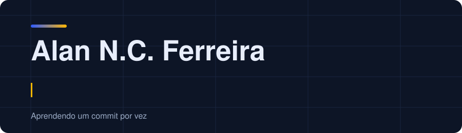

 

## Sobre mim

Estudante de tecnologia que aprende construindo. Tenho repositórios em PHP, Python e JavaScript, de sistemas web a trabalhos de faculdade.

## Tecnologias

## Projetos (clique para abrir)

 

 

## Perfil no GitHub

